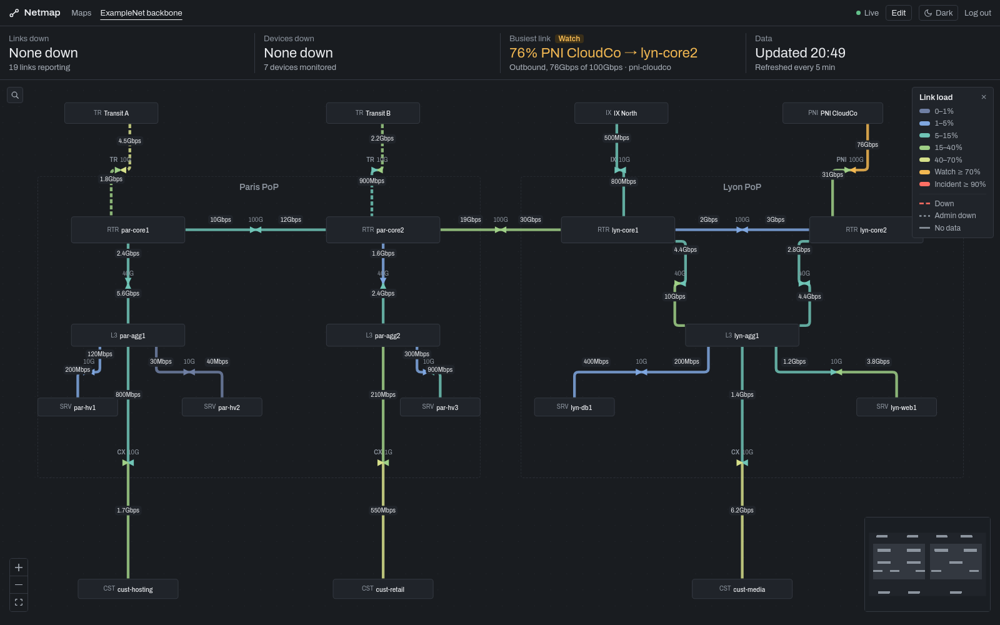
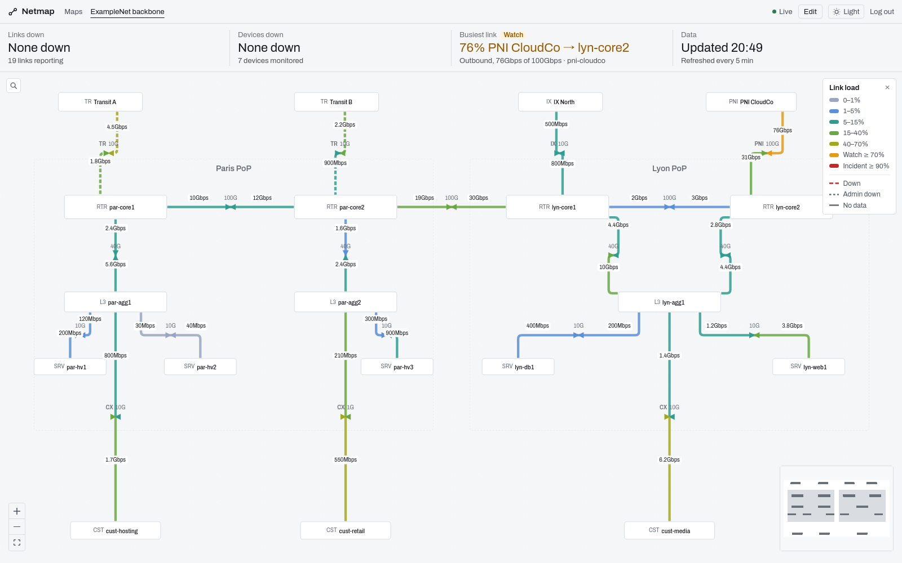
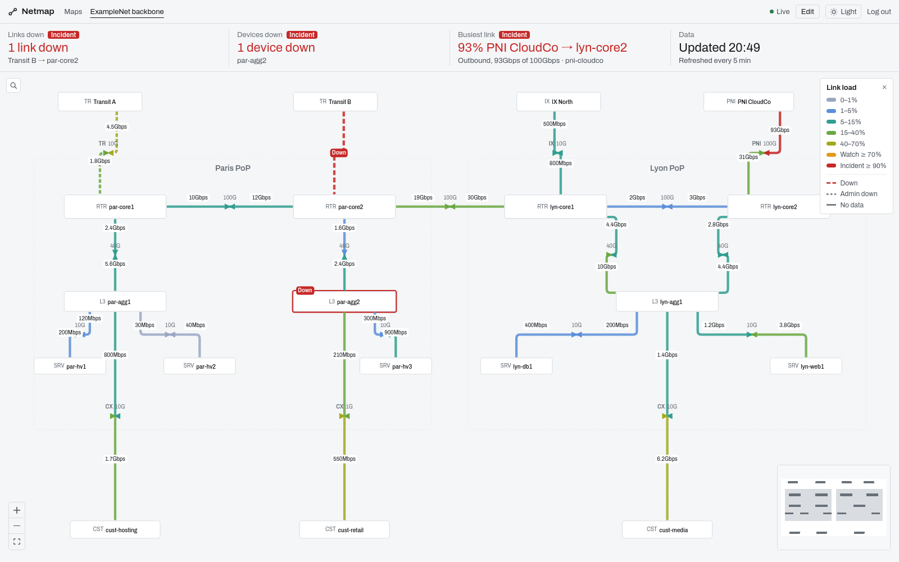
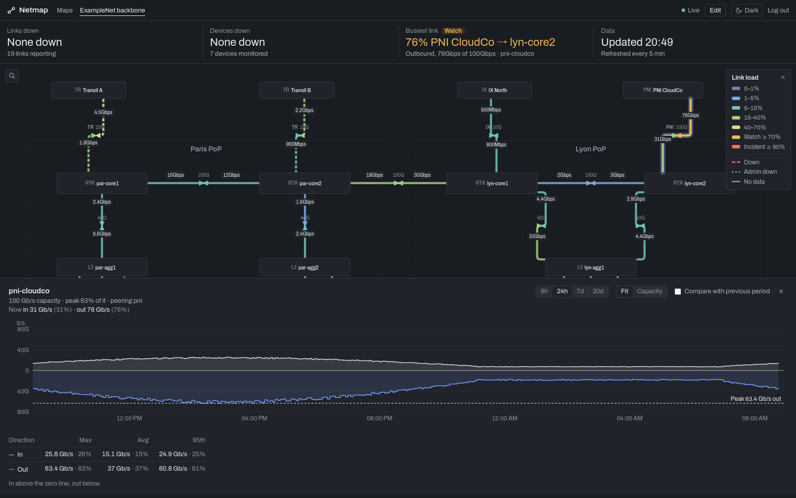
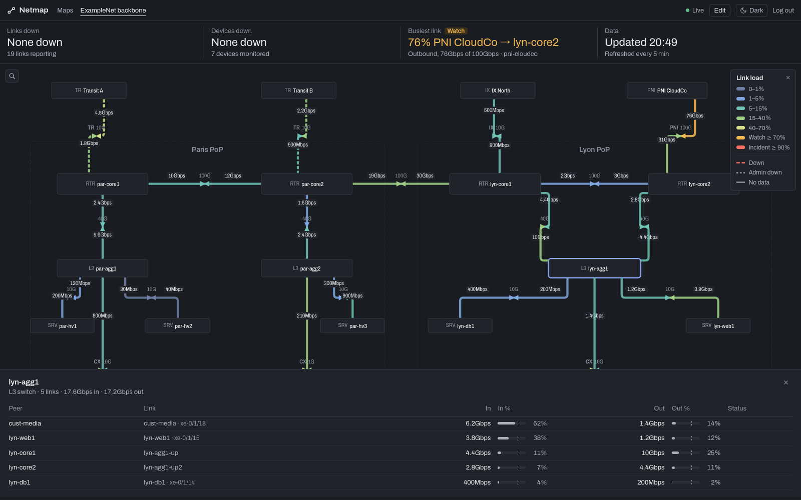
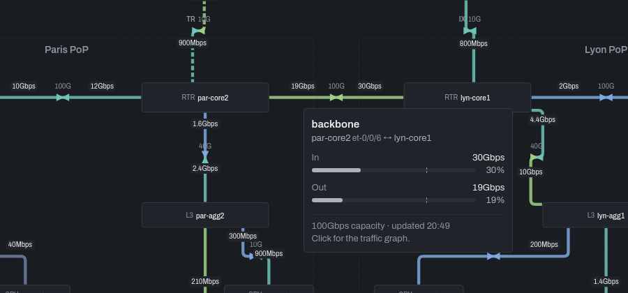
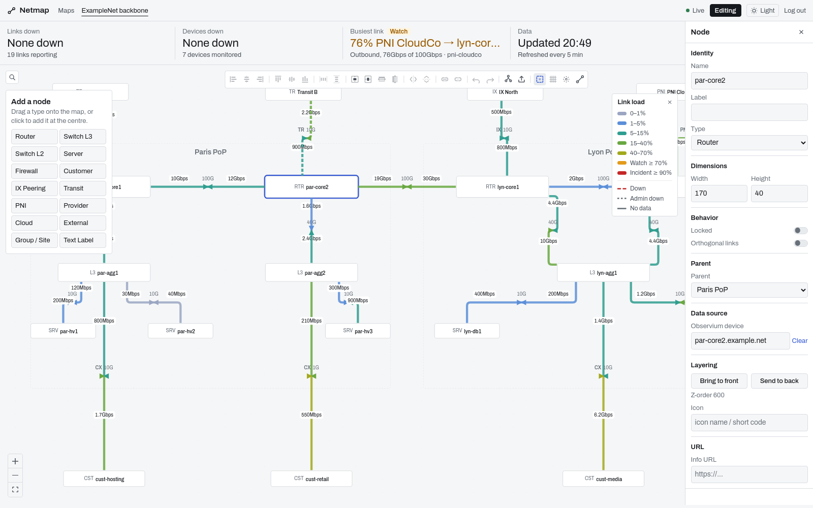
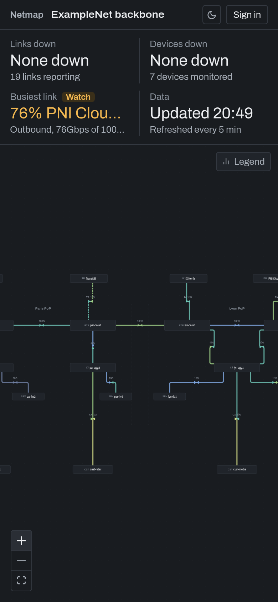

# Netmap NG

**A live network weathermap for Observium.** Open it on a wall screen, a laptop or a phone and see in one glance whether anything is wrong, where, and how loaded the network is. Then click any link or device for the details.

[](https://github.com/nextmap-io/netmap-ng/actions/workflows/ci.yml)
[](https://github.com/nextmap-io/netmap-ng/releases)
[](LICENSE)



<sub>All screenshots use an invented network ("ExampleNet"). No real infrastructure is shown.</sub>

Netmap NG is a modern successor to [PHP Network Weathermap](https://github.com/howardjones/network-weathermap/). It replaces static PNGs generated from text files with an interactive map you edit with the mouse, fed live by your Observium database.

## Why Netmap NG

- **It answers "is anything wrong?" first.** A *Right now* band at the top of every map counts links down, devices down, the busiest link and the age of the data. When everything is fine it stays quiet. When something isn't, it says so in words: *1 link down · Incident*, *76% PNI CloudCo → lyn-core2 · Watch*.
- **Calm when normal, loud when not.** Link load uses a pastel scale, from a dusty blue for idle links to lime for busy ones. Amber (Watch, ≥ 70%) and red (Incident, ≥ 90%) are kept for what needs attention, so a real problem stands out on a dense map.
- **Every element is clickable.**
  - Hover a link: endpoints, interfaces, in/out against capacity, and the time of the last poll.
  - Click it: a 6h / 24h / 7d / 30d traffic graph from the Observium RRDs, with the peak marked, the 95th percentile, and a comparison with the previous period.
  - Click a device: all of its links, busiest first.
- **Edited visually, bound to Observium.**
  - Drag and drop nodes, draw links, align and distribute, undo and redo.
  - Choose devices and ports from pickers fed by Observium; a link's capacity is filled in from the port speed.
- **Shareable without leaking.** A public link shows the map to anyone, with only the data you allow (percentages, rates, capacity, graphs). Observium IDs, hostnames and RRD paths never leave the server.
- **Built for real networks.**
  - Dense maps fit: node and label text is compact and scales with the zoom.
  - Dark, light and high-contrast SCADA themes.
  - Works on phones.
  - OIDC sign-in (Entra ID, Keycloak…) with viewer, editor and admin roles.

## Screenshots

| | |
|---|---|
|  **Light theme.** The same map; the theme follows your system or your choice. |  **When it goes wrong.** A transit link down, a switch down and a link at 93%: each one is named in the band and marked on the map. |
|  **Link graph.** Inbound above zero, outbound below, on one shared scale (fitted to the traffic or to the capacity), with the peak marked and Max / Avg / 95th per direction. |  **Device panel.** Click a node to list every link it carries, with traffic seen from that device. |
|  **Hover a link** for its endpoints, interfaces and how full it is. |  **Editor.** Node palette, alignment toolbar and property panel bound to Observium devices and ports. |

<p align="center"><br><sub>A shared public map on a phone.</sub></p>

## Quick start

You need Docker and read access to an Observium MySQL database. The RRD directory is optional and only used for the history graphs.

```bash
git clone https://github.com/nextmap-io/netmap-ng.git
cd netmap-ng
cp .env.example .env
# In .env set at least:
#   APP_SECRET_KEY   python -c "import secrets; print(secrets.token_urlsafe(32))"
#   OBSERVIUM_DB_HOST / OBSERVIUM_DB_USER / OBSERVIUM_DB_PASSWORD
#   OAUTH_* for your identity provider (or AUTH_DISABLED=true to try it locally)
docker compose -f docker-compose.prod.yml up -d
```

Open <http://localhost:3000>, create a map, click **Edit** and drag a router onto the canvas. To get the history graphs, mount the Observium RRD directory into the backend (see [Data sources](#data-sources)).

## How it works

```
 Observium MySQL (read-only) ──┐
   devices · ports · neighbours │      ┌──────────────────────┐      ┌──────────────────────┐
                                ├────▶ │  Backend (FastAPI)   │ ───▶ │ Frontend (React +    │
 Observium RRD files ───────────┘      │  maps · auth · API   │ JSON │ ReactFlow · Recharts)│
   /rrd/<host>/port-<ifIndex>.rrd       └──────────┬───────────┘      └──────────────────────┘
                                                   │
                                          SQLite (maps, nodes, links)
```

- **Live traffic**: rates are read from Observium's `ports` table, in one batched query per poll, through a small connection pool. Results are cached for 30 s, so many viewers do not multiply the load on Observium.
- **Status**: each link is `ok`, `down`, `admin_down`, `stale`, `nodata` or `unbound`, from the interface oper/admin status and the poll time. Each node is `up` or `down`, from the Observium device status.
- **History**: `rrdtool xport` runs asynchronously on the port RRD. Gaps are kept as gaps, never shown as zero.
- **Maps**: the map layout lives in SQLite; Netmap NG never writes to Observium.

## Features

<details>
<summary><b>Live map</b></summary>

- Zoomable, pannable canvas (mouse, touch, pinch), minimap, search across nodes.
- Links are split in two halves, inbound and outbound, each colored by its own utilization, with directional arrows and live rates or percentages.
- Routing per link: auto, straight, step, bezier or waypoints. Link types: internal, transit, IX, PNI, customer, trunk, LAG.
- Node types: router, L3/L2 switch, server, firewall, IX, transit, PNI, provider, cloud, internet, customer, plus groups (sites, racks) and free text labels.
- Utilization scale per map, in steps or gradient. Colors are theme tokens, so one scale reads well in dark, light and SCADA; custom hex colors are allowed too.
</details>

<details>
<summary><b>Monitoring</b></summary>

- *Right now* band: links down, devices down, busiest link, data age. Each fact is silent when normal and labelled **Watch** or **Incident** when not.
- Down links are drawn dashed in red with a "Down" badge, and administratively down links dashed in grey. Links with no data or no binding are greyed out; stale data is dimmed.
- A device that is down gets a red ring and a "Down" badge.
- Link graph:
  - mirror chart, inbound above zero and outbound below;
  - fitted to the traffic or to the link capacity;
  - peak annotation and previous-period overlay;
  - Max / Avg / 95th per direction, with the percentage of capacity.
</details>

<details>
<summary><b>Editor</b></summary>

- Drag and drop from a node palette, draw links by dragging between nodes, multi-select, copy (<kbd>Ctrl</kbd>+<kbd>D</kbd>), undo and redo.
- Align, distribute, flip, nudge with the arrow keys, snap to grid, automatic layout (organic or layered), PNG export.
- Property panel for nodes, links and multi-selections.
  - Observium device and port pickers.
  - A link's capacity is filled in from the port speed.
- Map settings: name, refresh interval, traffic scale editor, public sharing.
- Deleting asks for confirmation (attached links included) and runs as a single request. Failed edits roll back and say why. Press <kbd>?</kbd> for the full list of shortcuts.
</details>

<details>
<summary><b>Sharing &amp; access</b></summary>

- Visibility per map: private, internal (any signed-in user) or public (anyone with the link).
- For public links you choose what is shown: utilization %, rates, capacity, history graphs.
- OIDC sign-in with **viewer**, **editor** and **admin** roles taken from your identity provider's claims. Editors can only modify their own maps; admins can modify any map.
</details>

## Deployment

### Docker Compose (recommended)

`docker-compose.prod.yml` runs the published images (`ghcr.io/nextmap-io/netmap-ng-backend`, `…-frontend`), bound to `127.0.0.1`. Put a reverse proxy (nginx, Caddy, Traefik) in front for HTTPS. Images are multi-arch and published for every [release](https://github.com/nextmap-io/netmap-ng/releases).

### Next to an existing Observium server

```bash
# Backend
cd backend
python3 -m venv .venv && . .venv/bin/activate
pip install -r requirements.txt
uvicorn app.main:app --host 127.0.0.1 --port 8000 --workers 2   # run it under systemd

# Frontend: build once, serve frontend/dist with nginx (proxy /api and /auth to :8000)
cd ../frontend && npm ci && npm run build
```

On upgrades, run `pip install -r requirements.txt` and `npm ci && npm run build` again, then restart the backend; missing tables and data migrations are applied at startup. Back up the SQLite file first.

### Development

```bash
make backend-dev    # terminal 1 (AUTH_DISABLED=true in .env for local work)
make frontend-dev   # terminal 2, http://localhost:5173
make ci             # everything CI runs: ruff, mypy, pytest, eslint, tsc, vite build
```

See [CONTRIBUTING.md](CONTRIBUTING.md) for the workflow and [docs/DESIGN.md](docs/DESIGN.md) for the UI rules.

## Data sources

### Observium MySQL (read-only)

| Table | Used for |
|-------|----------|
| `devices` | Device inventory for the pickers; up/down status of bound nodes |
| `ports` | Interfaces for the pickers; live rates, speed, oper/admin status and poll time |
| `neighbours` | CDP/LLDP topology for discovery |

```sql
CREATE USER 'netmap_ro'@'%' IDENTIFIED BY '<password>';
GRANT SELECT ON observium.devices    TO 'netmap_ro'@'%';
GRANT SELECT ON observium.ports      TO 'netmap_ro'@'%';
GRANT SELECT ON observium.neighbours TO 'netmap_ro'@'%';
FLUSH PRIVILEGES;
```

### RRD files (history graphs)

Mount Observium's RRD directory read-only into the backend and point `OBSERVIUM_RRD_PATH` at it. The backend reads `<path>/<hostname>/port-<ifIndex>.rrd` (data sources `INOCTETS` / `OUTOCTETS`) with `rrdtool`.

```yaml
services:
  backend:
    volumes:
      - /opt/observium/rrd:/rrd:ro
    environment:
      - OBSERVIUM_RRD_PATH=/rrd
```

## Configuration

All settings are environment variables; [`.env.example`](.env.example) documents each of them, with examples for Entra ID and Keycloak.

| Variable | Default | Description |
|----------|---------|-------------|
| `APP_SECRET_KEY` | — | **Required.** Session signing key (min. 16 characters). |
| `APP_BASE_URL` | `http://localhost:8000` | Public URL, used for OAuth callbacks and secure cookies. |
| `APP_DB_URL` | `sqlite+aiosqlite:///./netmap.db` | Where maps are stored. |
| `AUTH_DISABLED` | `false` | `true` only for local development. |
| `PUBLIC_INDEX` | `false` | List public maps on `/welcome`. |
| `CORS_ORIGINS` | `http://localhost:5173,http://localhost:3000` | Allowed origins. |
| `OAUTH_CLIENT_ID`, `OAUTH_CLIENT_SECRET` | — | OIDC client. |
| `OAUTH_AUTHORIZE_URL`, `OAUTH_TOKEN_URL`, `OAUTH_USERINFO_URL` | — | OIDC endpoints. |
| `OAUTH_SCOPES` | `openid profile email` | Requested scopes. |
| `OAUTH_ROLES_CLAIM` | `roles` | Claim that holds the user's roles. |
| `OAUTH_EDITOR_ROLE`, `OAUTH_ADMIN_ROLE` | — | Role values for editors and admins (empty: every signed-in user can edit). |
| `OBSERVIUM_DB_HOST`, `OBSERVIUM_DB_PORT` | —, `3306` | Observium MySQL server. |
| `OBSERVIUM_DB_USER`, `OBSERVIUM_DB_PASSWORD`, `OBSERVIUM_DB_NAME` | —, —, `observium` | Read-only credentials. |
| `OBSERVIUM_RRD_PATH` | `/opt/observium/rrd` | Observium RRD directory. |

## Security

- **Authentication**
  - OIDC is required by default. Auth can only be turned off explicitly (`AUTH_DISABLED=true`), never silently.
  - Session cookies are `SameSite=Lax`, and `Secure` when served over HTTPS.
- **Authorization**: every write is checked for the editor or admin role, and for ownership of the map.
- **Public endpoints** return an explicit allow-list of fields per map: no Observium IDs, hostnames, RRD paths or info URLs.
- **Input safety**
  - SQL is parameterized only.
  - API inputs are validated with Pydantic (enums, lengths, bounds).
  - RRD file paths are validated and contained, and `rrdtool` runs with a timeout and a concurrency cap.
- **Headers and auditing**
  - Strict security headers, and a CSP of `'self'` in the frontend image. Fonts are self-hosted, so no third-party requests are made.
  - Every write is logged with the user's identity.
- **Supply chain**: dependencies are pinned, and CI rejects any package version published less than 7 days ago.

## Disclaimer

Netmap NG is an independent open-source project. It is **not affiliated with, endorsed by, or associated with** [Observium](https://www.observium.org/) or its team. Observium is a registered trademark of its respective owners. Netmap NG only reads Observium's data, read-only, like any third-party integration.

## License

[MIT](LICENSE)
